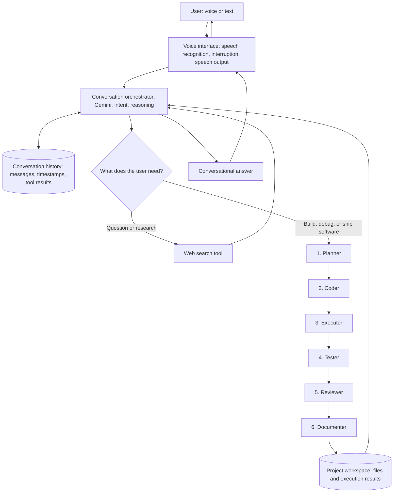

# Vyrexo — Design

## What it is

Vyrexo is a voice-first conversational AI agent. Users can speak or type naturally, ask follow-up questions, interrupt an in-progress task, and use web search to bring current information into the conversation.

For the minimi challenge, the relevant experience is straightforward: **ask Vyrexo a question, let it search the web when fresh information is needed, and continue the conversation without restating the context.** The same conversational interface can also route more complex requests into Vyrexo's software-engineering workflow.

## How it works

Vyrexo separates conversation from specialised execution:

1. **Conversation layer — Google Gemini.** Interprets the user's intent, manages the dialogue, decides whether fresh external information is needed, and turns retrieved evidence into a response.
2. **Web-search tool.** When a question depends on current facts, the agent invokes web search and uses the returned material as evidence. Search is a tool call, not a substitute for reasoning. The agent should distinguish sourced facts from inference and acknowledge inconclusive evidence.
3. **Conversation context.** Recent turns support follow-up questions such as "what about the second option?" Where stored conversation history is available, dated turns can be retrieved to resolve references to earlier discussions. The agent must not fabricate history it cannot retrieve.
4. **Voice interaction.** Speech recognition captures the user's request and text-to-speech delivers the response. Users can interrupt and redirect the agent.
5. **Specialised execution.** For larger software tasks, Vyrexo has a six-role engineering workflow: Planner, Coder, Executor, Tester, Reviewer, and Documenter. This extends the product beyond the basic conversational research flow.

## A typical turn

The agent first interprets the request. If it can answer from the available conversation context and model knowledge, it responds directly. If the answer may have changed, or the user asks for recent developments, pricing, releases, or verification, it uses web search. It then synthesises the relevant evidence, answers the specific question, and retains the exchange as conversation context.

For a question about an earlier conversation, the agent should first retrieve the relevant dated turns and establish what was actually discussed. If the user asks whether the earlier answer is still correct, the agent then searches for current evidence. These are separate steps: **recover what was said, then verify what is true now.**

## System architecture

Vyrexo has one conversational entry point and a coordinated execution path. Users do not need to choose an agent or know which model is doing the work. The conversation orchestrator interprets the request and can answer directly, call web search, or delegate a larger software-engineering task.

### The sources of truth

Vyrexo keeps three kinds of information conceptually distinct:

- **Conversation history — what the user said.** The actual messages, timestamps, and tool results for a session. This is what the agent should consult when a user asks "what did I ask last Tuesday?" or refers to something said earlier. Cross-session recall depends on persistent history being available; the agent must not claim to remember unavailable conversations.
- **Project workspace — what the agent changed or executed.** The current project files and execution artefacts. Plans, code changes, test results, and review findings should be grounded in the workspace rather than in a model's recollection of what it intended to do.
- **Web evidence — what external sources report now.** Search results provide time-sensitive information. Where available, source links and dates should be retained so claims can be checked.

In short: conversation history answers **what the user said**; web search helps establish **what is reported now**; the workspace records **what the agent actually built or executed**.

### The six-agent engineering workflow

For complex software tasks, the orchestrator can route work through six specialised roles:

1. **Planner** — translates the request into requirements, architecture, and an ordered execution plan.
2. **Coder** — implements and modifies project files using the dedicated coding model.
3. **Executor** — applies changes, manages dependencies, and coordinates the runnable workspace.
4. **Tester** — generates and runs tests, then reports failures and verification results.
5. **Reviewer** — checks implementation quality, security concerns, and potential regressions.
6. **Documenter** — updates project documentation and delivery artefacts.

These are coordinated roles, not six independent chatbots taking turns. Each role has a defined responsibility, and its output informs the next stage. The project workspace records the resulting files and execution artefacts. If testing or review identifies an issue, the workflow can return to implementation.

## Why this architecture

The conversational and coding workloads have different needs. Gemini handles dialogue, intent routing, and conversational reasoning; a separate coding engine handles deeper code-generation and debugging tasks. This avoids routing every simple question through the heavier engineering path. Voice is an interface to the same conversation, not a separate agent with a different source of truth.

The tool boundary matters too: the model decides when search is useful, while the search tool supplies external evidence. Keeping retrieval separate makes it easier to inspect, test, replace, and improve search without redesigning the conversation layer.

## What we considered and rejected

- **Searching on every message:** adds latency and can introduce irrelevant sources. Search should be triggered by freshness needs, explicit requests, or uncertainty.
- **Answering from model knowledge alone:** unsuitable for changing facts such as prices, product releases, and current availability.
- **One model for every task:** simpler initially, but couples fast conversation to heavier coding workloads.
- **Pretending the model remembers everything:** unsafe. Memory must come from retrievable conversation history; if the relevant history is unavailable, the agent should say so.
- **Running all six agents for every request:** unnecessary overhead for a simple question. The engineering workflow should be invoked only when the task warrants planning, implementation, execution, testing, review, and documentation.

## What we would improve with another week

Prioritise the challenge's evaluation cases: durable, timestamped conversation storage; retrieval by date, topic, and entity; source-aware web search with links and publication dates; and an explicit "then versus now" answer format. Add tests for follow-up references, stale pricing, conflicting sources, missing history, and questions that do not need search. Measure time to first response, total latency, retrieval accuracy, citation coverage, and answer correctness.

The guiding principle is simple: **remember what the user actually said, search when the world may have changed, and be transparent about what the evidence can and cannot support.**

Vyrexo starts as a conversation, becomes a researcher when the answer needs fresh evidence, and can become a coordinated engineering team when the user asks it to build. The same interface connects all three modes.
